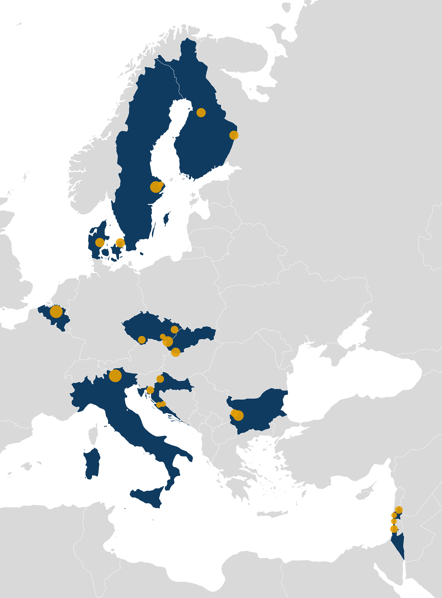

```{=html}
<style>
.cta { margin-top: 1.25rem; margin-bottom: 1.5rem; }
.cta .btn { margin: 0 0.75rem 0.5rem 0; }

/* The solana template centres its contents on narrow screens */
main li,
.contact p { text-align: left; }

.tier-row {
  display: grid;
  grid-template-columns: 1fr;
  gap: 1rem;
  margin-top: 1rem;
  margin-bottom: 1.5rem;
}
@media (min-width: 768px) {
  .tier-row { grid-template-columns: repeat(3, 1fr); }
}

.tier-card,
.dataset-box {
  background-color: #F2F6EF;
  border-radius: 4px;
  padding: 1rem 1.25rem;
  box-shadow: 0 1px 3px rgba(0, 0, 0, 0.1);
}
.tier-card { border-top: 5px solid #4C7D31; }
.dataset-box { border-left: 5px solid #4C7D31; margin-bottom: 1.5rem; }

.tier-card h3,
.dataset-box h3 { margin-top: 0; text-align: left; }
.tier-card p,
.tier-card li,
.dataset-box p,
.dataset-box li { text-align: left; }

.tier-card .tier-step {
  display: block;
  font-size: 0.8rem;
  font-weight: 700;
  letter-spacing: 0.05em;
  text-transform: uppercase;
  color: #6B7A63;
}
.tier-card .tier-shared {
  display: block;
  margin-bottom: 0.75rem;
  font-style: italic;
}
</style>
```

:::: {#hero-heading}

BiodivPond is building a transnational network of pond monitoring across Europe. We invite **national and regional agencies, scientific institutions, universities, and NGOs** that monitor ponds, or manage sites with ponds, to connect their sites and monitoring programmes to the network.

You do not need to change your existing methods to join. Choose the [tier](#tiers) that fits each of your sites or programmes: from registering them, through reporting to a common minimum dataset, to adopting the shared BiodivPond protocols.

::: {.cta}
[Express your interest](https://forms.gle/4cKSiFoKm55UukFz6){.btn .btn-primary .btn-lg role="button"}
:::

## Where the network stands

::: {.stat-row}
::: {.stat-card}
[60]{.stat-value}
[core ponds sampled in the 2026 season]{.stat-label}
:::
::: {.stat-card}
[10]{.stat-value}
[partner countries]{.stat-label}
:::
::: {.stat-card}
[~500]{.stat-value}
[ponds in the 2027 season, with the help of citizen scientists]{.stat-label}
:::
:::

In the 2026 season, the pilot partners sampled [60 core ponds](core_pond_dataset.qmd), grouped into pondscapes across the [partner countries](partners.qmd). All core ponds were sampled for eDNA, and most also with standardised traditional sampling and passive acoustic monitoring. The 2027 season will extend the network to around 500 ponds, with the help of citizen scientists. Establishing this network is the first of the [pilot objectives](index.qmd#objectives).

::: {.map-card}
::: {.map-card-text}
### Pondscapes sampled since 2026
Each marker on the map shows a pondscape in which core ponds were sampled since the 2026 season.
:::
::: {.map-card-image .map-portrait}
<div class="map-wrapper">

</div>
:::
:::

## Three tiers of membership {#tiers}

The tiers are cumulative: each tier includes the commitments of the one before it. You can join at any tier, connect different sites or programmes at different tiers, and move up later.

::: {.tier-row}
::: {.tier-card}
[Tier 1 · base]{.tier-step}

### Connected

[Shared focus]{.tier-shared}

**Common ground:** the pond ecosystem, regardless of spatial extent, taxonomic coverage or methods.

**You commit to:** register your programme and/or sites – a short description, location at a precision you choose, taxa, methods and a contact person – and keep this information up to date.
:::

::: {.tier-card}
[Tier 2 · middle]{.tier-step}

### Harmonised

[Shared data standard]{.tier-shared}

**You commit to:** keep your own field methods, but report your data to a common [minimum dataset](#minimum-dataset), so that data from different programmes can be combined.

**Open data:** data are published openly on GBIF under the network, following the Darwin Core standard. We encourage members to also publish them in their national species occurrence databases.
:::

::: {.tier-card}
[Tier 3 · full]{.tier-step}

### Integrated

[Shared protocols]{.tier-shared}

**You commit to:** adopt the shared BiodivPond protocol, to be published openly, for one or more of the methods: traditional sampling, eDNA, or passive acoustic monitoring (PAM).

**Result:** full comparability with the core ponds, allowing joint analyses and method comparisons.
:::
:::

::: {.dataset-box #minimum-dataset}
### Minimum dataset (draft)

The minimum dataset covers pond-level descriptors and species occurrences. The starting point below is a draft, to be agreed with the members:

- pond ID, location and country
- sampling date, sampling method and effort
- taxonomic scope (genus, species), matched to the Catalogue of Life Extended Release
- life stage and abundance, where recorded
- basic pond characteristics, based on the BiodivPond core pond survey form, which will be shared
:::

## Why join

### What members get

- **Visibility:** your sites and programmes shown on the network map and pages.
- **Shared know-how:** access to the shared field protocols, training and webinars, and invitations to network workshops.
- **Data publishing support:** help with publishing your data to GBIF and Zenodo, using the open data pipelines on [GitHub](https://github.com/BiodivPond).
- **Partners:** a pool of partners for consultation and for joint funding applications.
- **Co-authorship:** members whose data are used in a network study are offered co-authorship, under a data-use policy to be agreed with the members.

### Why it matters

- Ponds are the most numerous freshwater habitats and hold a disproportionate share of freshwater biodiversity, yet they are largely missing from the Water Framework Directive and many national monitoring schemes.
- Connected, comparable pond data support the Nature Restoration Regulation, the EU Biodiversity Strategy for 2030, the Water Resilience Strategy, Habitats Directive reporting, and national and European Red List assessments.
- The data contribute to Essential Biodiversity Variables, as outlined by EuropaBON, and to indicators for freshwater condition and bat activity.
- Pooling programmes across biogeographical regions shows patterns that no single country can see alone, and reduces duplicated effort and investment.
- The pilot compares eDNA, acoustic and traditional methods side by side; members can draw on that evidence when designing or updating their own programmes.
- eDNA can flag invasive species early, such as *Xenopus*.

### What members bring

- Existing programmes often hold long time series and expert knowledge that a three-year pilot cannot produce. Connecting them gives the network depth in time as well as in space.
- Sites in under-covered regions and pond types fill gaps in the network.

## Build it together

The network is co-developed: members shape the minimum dataset, the protocols and the data-use policy. It is being built during the pilot (2026–2028) with the aim of continuing beyond it; how it is run after the pilot will be agreed with its members.

## How to join

1. Fill in the [expression-of-interest form](https://forms.gle/4cKSiFoKm55UukFz6).
2. We get in touch to discuss your sites, programme and the tier that fits.
3. Your sites and programme are added to the network.

::: {.cta}
[Express your interest](https://forms.gle/4cKSiFoKm55UukFz6){.btn .btn-primary .btn-lg role="button"}
:::

::: {.contact}
Questions? Email [jonas.gaigr@aopk.gov.cz](mailto:jonas.gaigr@aopk.gov.cz).
:::

::::
